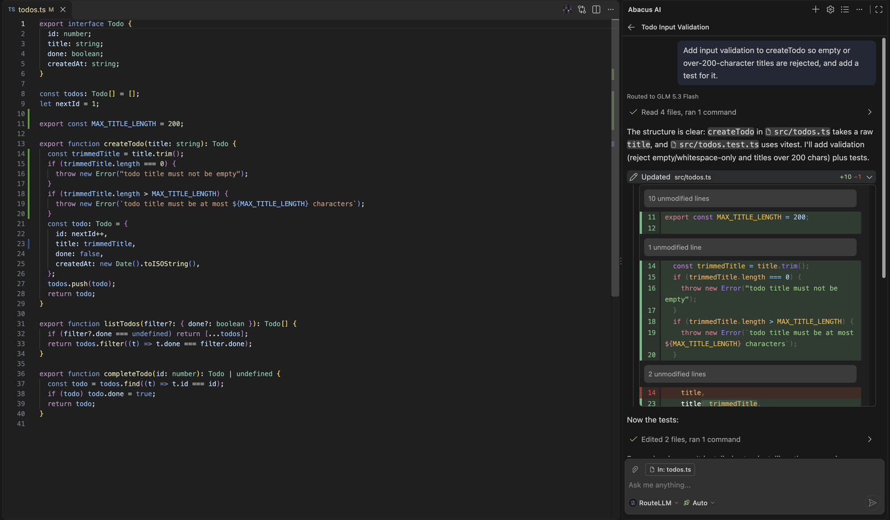

# Abacus AI Agent

Abacus AI Agent is a coding agent that works with any model. Hand it a task and it reads your project, plans, edits files and runs commands, and you decide how much it does on its own. Use it in VS Code, in your terminal with the `abacusai` CLI, or in the Abacus AI Desktop app, with the same account and conversation history.



## Get started

**VS Code.** Install [Abacus AI Agent](https://marketplace.visualstudio.com/items?itemName=abacusai.abacusai-agent) from the Marketplace. It is also on [Open VSX](https://open-vsx.org/extension/abacusai/abacusai-agent) for VS Code-compatible editors. Open the **Abacus AI** view and sign in.

**CLI.** On macOS, Linux and WSL:

```sh
curl -fsSL https://static.abacus.ai/cli/install.sh | bash
```

On Windows (PowerShell):

```powershell
irm https://static.abacus.ai/cli/install.ps1 | iex
```

Or with npm (Node 18 or later):

```sh
npm install -g @abacus-ai/cli
```

Then run `abacusai` in your project and sign in with `/login`.

**Desktop.** Download the app from [desktop.abacus.ai](https://desktop.abacus.ai/).

## Use any model

- **One Abacus.AI plan.** Claude, GPT and Gemini families plus open models such as Kimi, Qwen, DeepSeek and GLM. RouteLLM can pick a model for each turn.
- **Your ChatGPT subscription.** If Codex is signed in with ChatGPT, the agent detects it and offers those models.
- **Your API keys.** OpenAI, Anthropic and Google keys, stored in your OS keychain.
- **Local and OpenAI-compatible models.** Ollama, LM Studio, vLLM, Groq, Together, OpenRouter, DeepSeek or any OpenAI-compatible endpoint.

Switch models mid-conversation, even across providers.

## Reporting bugs

Run `/feedback` in the CLI, or [open an issue](https://github.com/abacusai/abacusai-desktop/issues/new/choose) here. Please include:

- the product and version (`abacusai --version`, or the extension version in VS Code's Extensions view)
- your OS
- steps to reproduce, and what you expected to happen

## Support

- Email: support@abacus.ai
- [Documentation](https://abacus.ai/help/abacusai-desktop/introduction)
- [FAQ](https://desktop.abacus.ai/desktop_faq)

## Data and privacy

Your code is not used for training. Abacus.AI has zero data retention agreements with model providers, and data is encrypted in transit. With a local provider, nothing about the turn reaches Abacus.AI. See the [privacy policy](https://abacus.ai/privacy) and [terms of service](https://abacus.ai/terms).

---

The source code is not public. This repository tracks issues and feedback.
